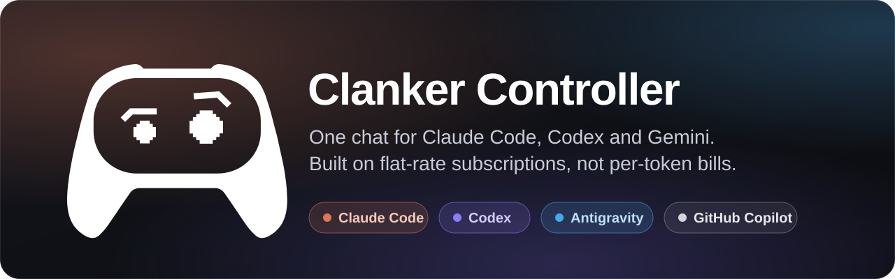
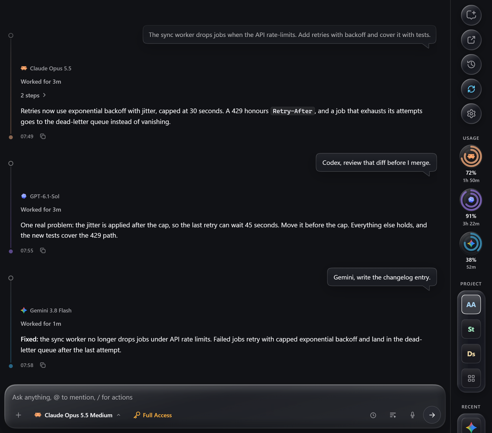
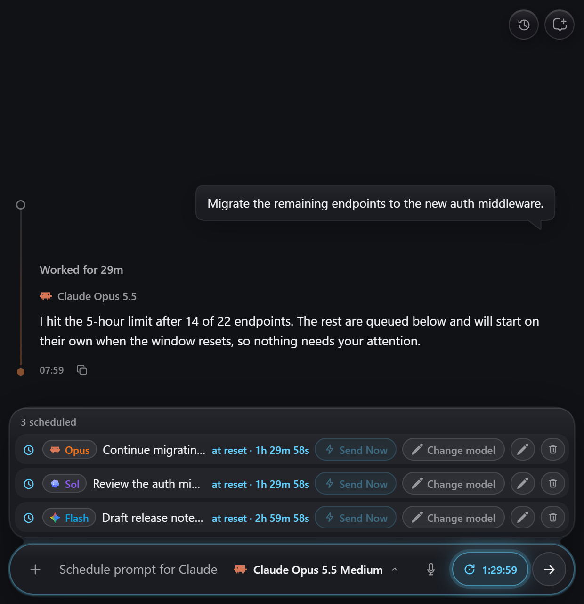
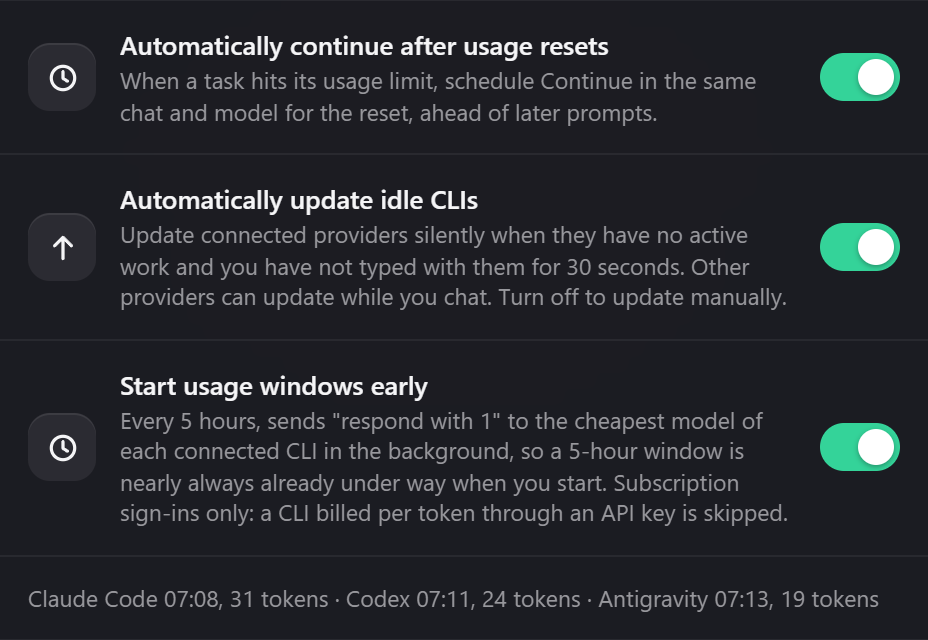
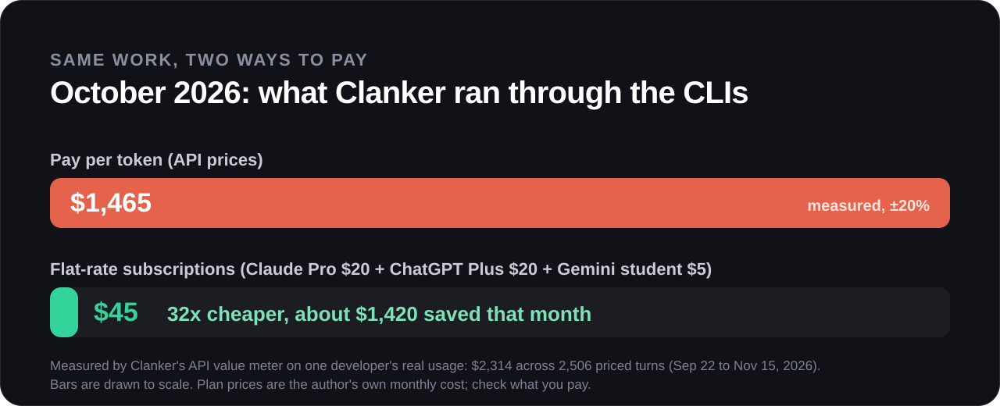
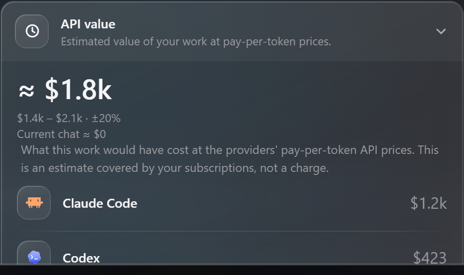

<p align="center">
  
</p>

**Clanker Controller** is an IDE extension that puts your coding agents in one chat window. Claude Code, Codex, Antigravity (Gemini) and GitHub Copilot sit side by side. You pick a model per message. It drives the official CLIs you already have installed, so you keep your sign-ins, your plans and your setup. You give nothing up.

It runs in **Antigravity** and **VS Code**.

<p align="center">
  
</p>

> The picture above is the real chat page with invented demo data. [`scripts/readme-shots.mjs`](scripts/readme-shots.mjs) renders every screenshot in this README.

## Why you would want this

- **Every agent in one place.** One conversation can go from Claude to Codex to Gemini. Each agent gets a condensed briefing of what the others did, and nothing is thrown away: every shortened part points to a full transcript it can open.
- **A usage indicator you can read at a glance.** Each provider gets a ring with the percentage left in its 5-hour window and the time until it resets.
- **A scheduler.** Hit a limit at 2 a.m.? The next prompt waits for the reset and runs by itself. You can also schedule prompts for a clock time.
- **Usage windows that start early.** A tiny background ping keeps each 5-hour window rolling, so one is nearly always already under way when you sit down.
- **Subscriptions first.** A flat plan costs far less than the same work at API prices. [The math is below.](#the-math-subscriptions-vs-api-prices)

## Keep your Claude Code and Codex setup

Clanker does not replace your tools. It runs the real `claude`, `codex` and `agy` CLIs headlessly and streams what they do into the chat.

- Your **own CLI sign-ins and plans** stay as they are. The coding agents run on those sign-ins, so Clanker needs no API key for them and never bills you. Voice dictation uses its own free Groq key, which is optional.
- Sessions stay native. A Codex thread keeps syncing with the ChatGPT app, and Claude Code can still be opened in the Claude app through Remote Control.
- Use each environment next to the others, in the same chat, on the same project.
- Add another CLI with one provider file. The GitHub Copilot CLI is the worked example: [adding a provider](docs/adding-a-provider.md).

## A scheduler that works while you sleep

When a task runs into its usage limit, Clanker queues **Continue** for the reset, in the same chat, model and project. You can also schedule any prompt for a clock time or queue it behind the running task, reorder the queue by dragging, and move a waiting prompt to another provider with **Change model**.

<p align="center">
  
</p>

The IDE has to stay open for scheduled prompts to run.

## Start usage windows early

Subscription limits work in rolling 5-hour windows that begin with your first message. Clanker can start the window for you: every 5 hours it sends "respond with 1" to the cheapest model of each connected CLI, from an empty temporary folder with tools off. It costs a few tokens, and it only touches CLIs signed in with a subscription. A CLI billed per token through an API key is never pinged.

<p align="center">
  
</p>

No PC running? An experimental option runs the warm-ups in your own Google Cloud project on a weekly calendar: [setup, costs and removal](docs/cloud-usage-windows.md).

## The math: subscriptions vs API prices

Clanker keeps an **API value** meter. For every turn it prices the tokens at each provider's pay-per-token rates and adds them up. It is a comparison, not a bill: the work itself ran on your subscriptions.

<p align="center">
  
</p>

How to read it. These numbers are the maintainer's own: real usage and the plans the maintainer actually pays for.

| Measure | Value |
|---|---|
| Work measured | Sep 22 to Nov 15, 2026, 285 chats, 2,545 priced turns |
| At API prices | **$1,751** in total (±20%), about $1,000 a month |
| By provider | Claude Code $1,169 · Codex $423 · Antigravity $160 |
| October alone | **$989** at API prices |
| Subscriptions | Claude Pro $20 + ChatGPT Plus $20 + Gemini student plan $5 = **$45 a month** |
| Result | 989 ÷ 45 ≈ **22x cheaper**, about $940 saved in October |

Read the comparison with care. The API value is an estimate with a ±20% band, and turns on models without a known price count as zero rather than a guess. Claude turns are priced from their token counts at Anthropic's list prices, because Claude Code's own cost figure runs about 1.8x too high for Sonnet 5.x. Prices were last checked on 2026-11-15. Plan prices change, so plug in what you pay. The trade is that a subscription has usage windows instead of a pay-as-you-go meter, and the scheduler and early window starts exist to make those windows painless.

<p align="center">
  
</p>

You can see your own number under **Chat Settings > General > API value**.

## And more

- **Voice dictation.** A global hotkey, speech to text through Groq Whisper, and a personal dictionary that learns your project's names.
- **Projects.** Each chat is bound to one project root that stays explicit across queued and scheduled turns.
- **Telegram and a Cloudflare tunnel** to check on a long task from your phone.
- **Loops.** Unattended review and fix runs with their own token budgets.
- **Liquid Glass UI.** Movable chat windows, a launcher rail, and a composer that behaves like a Dynamic Island.

## Install

You need Node.js, Antigravity or VS Code, and at least one CLI: Claude Code, Codex, Antigravity or GitHub Copilot.

```bash
git clone https://github.com/Alexander-Ettl/Clanker-Controller.git
cd Clanker-Controller
npm install
node scripts/install-extension.mjs        # vscode, antigravity or all; add --link to develop live
```

Reload the IDE window. The first-run guide connects your CLIs, sets up voice and routing, or offers **Set up with AI** to walk you through it. You can reopen it anytime from **Chat Settings > General > Setup guide**.

On Windows you can also run `ai-chat-panel/install-into-antigravity.ps1 -Link`. Built and used daily on Windows; the installer also works on Linux and macOS, but voice dictation is Windows-only for now.

## Repository

| Folder | What it is |
|---|---|
| [`ai-chat-panel/`](ai-chat-panel/README.md) | The extension: chat UI, scheduler, projects, CLI runners |
| [`voice-router/`](voice-router/README.md) | Native capture, transcription and prompt routing |
| [`antigravity-usage-statusbar/`](antigravity-usage-statusbar/README.md) | Usage and quota status extension |
| [`docs/`](docs/README.md) | Guides, specifications and proposals |

Working on the code? Start with the [development guide](docs/development.md), [AGENTS.md](AGENTS.md) and the backlog in [TODO.md](TODO.md).
