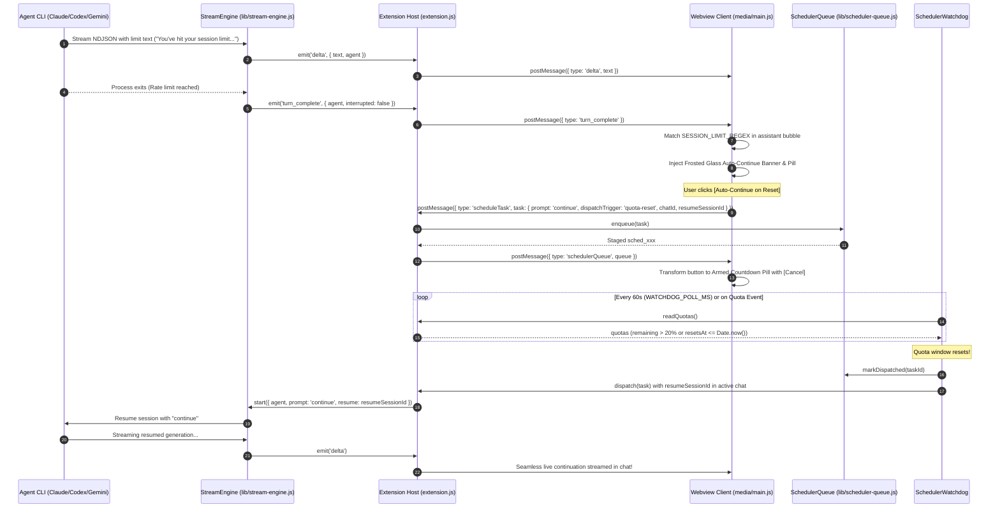

> Historical implementation blueprint, archived 2026-10-22. Auto-continue is described in the [development guide](../development.md#usage-windows-and-cli-maintenance); unchecked lists below don't establish remaining work. Use the [current backlog](../../TODO.md). Embedded prompts and implementation instructions are historical context.

# Architectural Specification: Auto-Continue on Usage / Session Limit Reset (P17-AB)

> **Document Type:** System Architecture, IPC Protocol & UI/UX Implementation Specification  
> **Target Module:** `astro-visual-editor/tools/ai-chat-panel` (VS Code Extension & Webview Studio)  
> **Related Systems:** `lib/scheduler-queue.js`, `lib/stream-engine.js`, `lib/quota-bridge.js`, `media/main.js`, `extension.js`  
> **Design Paradigm:** Apple Liquid Glass Frosted UI, Non-Blocking Reactive Queuing, Fail-Safe Automation  

---

## 1. Executive Summary & Problem Definition

### 1.1 The User Scenario
When interacting with frontier AI coding agents (Claude 3.7 Sonnet / Opus, OpenAI Codex, Google Gemini 2.5 / 3.8 Flash), multi-step refactorings and complex tasks frequently exhaust the active session quota or rate limits mid-execution. For instance, Claude Code CLI emits:

```text
You've hit your session limit · resets 6:30pm (Europe/Berlin)
```

In the current AI Chat Panel implementation:
1. The turn halts abruptly, streaming this raw error delta into the assistant bubble.
2. The user is forced to mentally track the reset timestamp, keep the window open, or manually remember to return later.
3. Once the quota resets, the user must manually type `"continue"` and submit.

### 1.2 The Goal: Zero-Friction Autonomous Continuation
When an AI agent halts due to quota or session limit exhaustion:
- An elegant, frosted glass notification and action pill (`[ 🕒 Auto-Continue on Reset ]`) automatically renders right at the end of the message adjacent to the limit notice.
- Clicking the pill automatically enqueues a synthetic `"continue"` prompt into `SchedulerQueue` with `dispatchTrigger: 'quota-reset'`, locked to the active chat session (`chatId`) and conversational thread (`resumeSessionId`).
- The button dynamically morphs into a live countdown indicator (e.g., `🕒 Auto-continue armed: firing in 14m 22s · [Cancel]`).
- The moment the upstream quota watchdog verifies the reset, it automatically dispatches `"continue"`, seamlessly picking up the agent's work right where it left off without user intervention.

---

## 2. System Architecture & Event Flow



---

## 3. Detection Engine & Pattern Matching

To reliably detect session exhaustion across multiple agent CLI formats, detection operates at two synergistic levels:

### 3.1 Streamed Message Delta & Error Heuristics
Located in `media/main.js` during `appendAssistantDelta` and `endAssistantTurn`:

```javascript
/**
 * Universal Regex matching session limit / quota exhaustion notices across CLIs.
 */
const SESSION_LIMIT_REGEX = new RegExp([
  'hit\\s+(?:your\\s+)?session\\s+limit',
  'session\\s+limit\\s+(?:reached|exceeded)',
  'quota\\s+(?:exhausted|exceeded|limit)',
  'rate\\s+limit\\s+(?:exceeded|reached)',
  'out\\s+of\\s+(?:usage|credits|quota)',
  'resets\\s+\\d{1,2}:\\d{2}\\s*(?:am|pm)?'
].join('|'), 'i');

/**
 * Extracts reset time string if explicitly embedded in the agent's text.
 * Example: "resets 6:30pm (Europe/Berlin)" -> "6:30pm (Europe/Berlin)"
 */
function extractEmbeddedResetTime(text) {
  const match = text.match(/resets\s+([0-9]{1,2}:[0-9]{2}\s*(?:am|pm)?(?:\s*\([^)]+\))?)/i);
  return match ? match[1].trim() : null;
}
```

### 3.2 Live Quota Bridge Integration
In addition to text scanning, `lastQuotas` received from `quota-bridge.js` / `antigravity-usage-statusbar` provides authoritative epoch timestamps:
- Claude: `lastQuotas.claude?.resetsAt` (in seconds since epoch)
- Codex: `lastQuotas.codex?.resetsAt`
- Gemini: `lastQuotas.gemini?.resetsAt`

---

## 4. UI/UX Design: Apple Liquid Glass Banner & Action Pill

### 4.1 Visual Placement
The Auto-Continue element is appended directly inside the affected assistant message bubble (`.msg-assistant`), placed immediately after the text content before `.msg-actions`:

```html
<div class="msg-limit-continue-banner glass" data-agent="claude">
  <div class="limit-banner-content">
    <div class="limit-banner-header">
      <svg class="limit-clock-icon" viewBox="0 0 16 16" fill="none" aria-hidden="true">
        <circle cx="8" cy="8" r="6" stroke="currentColor" stroke-width="1.2"/>
        <path d="M8 4.5v3.5l2.2 1.4" stroke="currentColor" stroke-width="1.3" stroke-linecap="round" stroke-linejoin="round"/>
      </svg>
      <span class="limit-banner-title">Session Limit Reached</span>
      <span class="limit-banner-reset-badge">Resets at 6:30 PM (in 14m)</span>
    </div>
    <div class="limit-banner-actions">
      <button type="button" class="btn-continue-on-reset glass-button" aria-label="Auto-continue when quota resets">
        <svg viewBox="0 0 16 16" fill="none" aria-hidden="true">
          <path d="M4 8h8M8 4l4 4-4 4" stroke="currentColor" stroke-width="1.5" stroke-linecap="round" stroke-linejoin="round"/>
        </svg>
        <span>Auto-Continue on Reset</span>
      </button>
    </div>
  </div>
</div>
```

### 4.2 Armed & Scheduled State
Once clicked, the banner transitions via smooth CSS micro-animation into an active scheduled state:

```html
<div class="msg-limit-continue-banner glass is-scheduled" data-task-id="sched_1727198800_ab42">
  <div class="limit-banner-content">
    <div class="limit-banner-header">
      <span class="limit-pulse-dot"></span>
      <span class="limit-banner-title">Auto-Continue Scheduled</span>
      <span class="limit-banner-countdown">Auto-sending "continue" in 14:18...</span>
    </div>
    <div class="limit-banner-actions">
      <button type="button" class="btn-cancel-continue glass-button-subtle" title="Cancel automatic continuation">
        <span>Cancel</span>
      </button>
    </div>
  </div>
</div>
```

### 4.3 Styling Specifications (`media/style.css`)
- **Liquid Glass Frosting:** `background: rgba(255, 255, 255, 0.05)`, `backdrop-filter: blur(16px)`, `border: 1px solid rgba(255, 255, 255, 0.12)`.
- **Accent Tints:** Warm amber glow on limit detection (`rgba(245, 158, 11, 0.15)` border), transitioning to kinetic emerald pulse (`rgba(16, 185, 129, 0.2)`) when armed.
- **Button Micro-interactions:** Spring hover scale `transform: scale(1.02)`, active press `scale(0.98)`, SF Pro typography with `letter-spacing: -0.01em`.

---

## 5. IPC Contract & Data Structures

### 5.1 Webview to Extension Host Messages

#### Enqueue Auto-Continue Task
```typescript
interface ScheduleTaskMessage {
  type: 'scheduleTask';
  task: {
    model: 'claude' | 'codex' | 'gemini';
    modelId?: string;
    prompt: 'continue';
    dispatchTrigger: 'quota-reset';
    /** Direct reference to active chat session for continuity */
    chatId: string;
    /** Underlying CLI conversation/session UUID to pass to --resume */
    resumeSessionId?: string;
  };
  attachments: string[];
}
```

#### Cancel Scheduled Task
```typescript
interface CancelScheduledTaskMessage {
  type: 'cancelScheduledTask';
  taskId: string;
}
```

### 5.2 Extension Host to Webview Broadcasts
The existing `type: 'schedulerQueue'` payload is enhanced to include `chatId` and `isAutoContinue: boolean` so the banner in the chat transcript accurately reflects its persistence state across restarts or window reloads.

---

## 6. Execution Engine & Session Continuity Architecture

### 6.1 Enhancing `SchedulerQueue` (`lib/scheduler-queue.js`)
The `task` schema stored in `scheduler-queue.json` is augmented with conversational binding fields:

```javascript
const scheduled = {
  id,
  model: task.model,
  ...(task.modelId && task.modelId !== 'auto' ? { modelId: String(task.modelId) } : {}),
  prompt: String(task.prompt),
  attachments,
  dispatchTrigger: task.dispatchTrigger,
  status: 'pending',
  retryCount: 0,
  createdAt: new Date().toISOString(),
  // P17-AB: Chat Session Anchors
  chatId: task.chatId || null,
  resumeSessionId: task.resumeSessionId || null,
  isAutoContinue: task.prompt === 'continue' && Boolean(task.chatId)
};
```

### 6.2 Context-Aware Dispatch in `SchedulerWatchdog` (`extension.js`)
Currently, `SchedulerWatchdog.dispatch()` spawns an isolated standalone chat:
```javascript
// Legacy isolated behavior:
this.chat = this.chatStore.save({ ...this.chatStore.create(), title: `Scheduled: ${task.prompt.slice(0, 40)}`, ... });
```

Under the P17-AB contract, `dispatch(task)` checks if `task.chatId` exists:
1. **Existing Chat Continuity:** If `task.chatId` is valid, it retrieves the original chat from `this.chatStore.load(task.chatId)`.
2. **Transcript Insertion:** It appends `{ role: 'user', text: 'continue', agent: task.model }` directly into the existing chat thread.
3. **Session Resumption:** It passes `resume: task.resumeSessionId || this.chat.sessions?.[task.model]?.id` to `StreamEngine.start()`.
4. **Live Webview Binding:** If the user has that chat open, the webview is notified to render the new user bubble and stream assistant deltas in place.

---

## 7. Verification & Edge Case Handling Matrix

| Scenario | System Behavior | Recovery Mechanism |
| :--- | :--- | :--- |
| **User switches chats while scheduled** | Task remains safely persisted in `scheduler-queue.json`. | Dispatches quietly in background; updates `chatStore`. Badge in Manage Chats shows new activity. |
| **VS Code reloads / PC restarts** | Task persists on disk. Status remains `pending` with `dispatchTrigger: 'quota-reset'`. | Watchdog reads quotas upon startup and triggers as soon as quota is positive. |
| **Quota resets early or CLI misreports** | Watchdog polls every 60s and listens to `quota-bridge.js` updates. | Dispatches as soon as `quotaAvailable` threshold (>20% or reset epoch reached) evaluates truthy. |
| **Session resume token invalid / expired** | CLI reports `RESUME_FAILED` (e.g. session purged upstream). | `StreamEngine` fallback automatically falls back to full conversational handoff re-submission. |
| **User clicks Cancel before reset** | Webview posts `cancelScheduledTask`. | Queue marks task `cancelled`; banner reverts to idle state. |

---

## 8. Implementation Checklist for Downstream Execution

- [ ] **Webview (`media/main.js`):** Add `SESSION_LIMIT_REGEX` match inside `endAssistantTurn` and `appendAssistantDelta`.
- [ ] **Webview (`media/main.js`):** Implement `renderLimitContinueBanner(bubble, agent, resetTime)`.
- [ ] **Webview (`media/main.js`):** Add live countdown timer loop for active scheduled tasks.
- [ ] **Webview (`media/style.css`):** Add Liquid Glass styles for `.msg-limit-continue-banner`, `.is-scheduled`, and pulse animations.
- [ ] **Extension Host (`extension.js`):** Update `handleMessage` for `scheduleTask` to propagate `chatId` and `resumeSessionId`.
- [ ] **Scheduler Engine (`lib/scheduler-queue.js`):** Accept and persist `chatId` and `resumeSessionId`.
- [ ] **Watchdog (`extension.js`):** Update `SchedulerWatchdog.dispatch()` to load existing chat and pass resume tokens when `task.chatId` is present.
- [ ] **Verification:** Test simulated quota limit with Claude Code CLI and Codex rate limit line.
