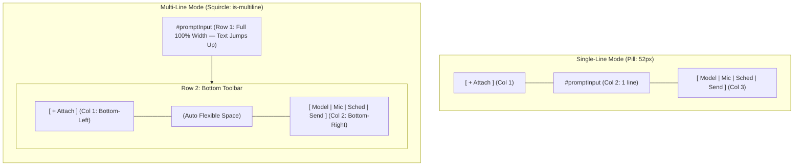

> Historical composer blueprint, archived 2026-10-22. Use the [current composer rules](../dynamic-island-composer-spec.md) and [backlog](../../TODO.md). Approval labels and embedded handoff prompts below describe the old design process, not new instructions.

# Phase 17 Extension: Dynamic Multiline Pill-to-Squircle Transition (Codex / ChatGPT Layout Parity)
## Architecture Specification & Execution Contract (P17-G)

**Author:** Gemini 3.8 Flash High (Systems Architect & Protocol Author)  
**Target Agent:** Claude Sonnet 5 High (Frontend / UI / Presentation Specialist)  
**Standard:** Tesler's Law (Complexity Absorption) & Liquid Glass Motion Standards  
**Status:** Approved Master Blueprint & Implementation Contract  

---

## 1. Problem Audit & Visual Critique

### 1.1 The Baseline Single-Line Pill
In `astro-visual-editor/tools/ai-chat-panel`, the `.composer` container is styled as a 52px compact pill (`border-radius: 26px`, padding `8px`). All items sit inline in a single horizontal flex line:
```text
[ + (Attach) ]  [ #promptInput (1 line) ]  [ Model Picker | Mic | Clock | Send ]
```
This is a polished, compact design for single-line queries.

### 1.2 The Multi-Line Degradation (Referenced Attachments)
- Local Image: [`site/.astro/session/attachments/1790129585078_image.png`](file:///c:/Users/user/Nextcloud/Eigene%20Projekte/Portfolio/2026/site/.astro/session/attachments/1790129585078_image.png)
- Local Image: [`site/.astro/session/attachments/1790129591694_image.png`](file:///c:/Users/user/Nextcloud/Eigene%20Projekte/Portfolio/2026/site/.astro/session/attachments/1790129591694_image.png)

When the author enters more than one line of text (or enters a long prompt):
1. `autoGrow()` expands the textarea's height up to 140px. The `.composer` container height expands from `52px` to `~168px`, taking on a squircle shape.
2. **The Layout Trap:** Because `.composer` remains a single-row flexbox (`display: flex; align-items: flex-end;`):
   - The textarea `#promptInput` is horizontally squeezed between `#attachBtn` on the left and `.composer-actions` on the right.
   - The text only occupies a narrow central channel (`~380px` out of `~680px`), indented `~95px` from the left edge and padded `~200px` from the right edge.
   - Massive empty dark voids appear in the top-left (above `+`) and top-right (above the action buttons).
   - The text floats awkwardly in the upper-middle while the buttons sit anchored at the bottom edge.

### 1.3 Target Paradigm: Codex & ChatGPT Chatbar Mechanics
In modern native AI chatbars (OpenAI Codex, ChatGPT, Claude desktop):
1. **Single-Line Mode:** Unified inline pill (`[+] [Input] [Actions]`).
2. **Multi-Line Mode (> 1 line):**
   - **Text Jumps to the Top:** The textarea transitions to the top and spans **100% full width** across the card.
   - **Bottom Action Toolbar:** The buttons drop down into a dedicated bottom toolbar row:
     - Bottom-Left: `[+]` attach button.
     - Bottom-Right: Model picker pill, voice/mic pill, schedule toggle, send button.
   - **Spring Physics Morph:** A smooth transition on `height`, `border-radius` (`26px` &rarr; `20px`), and spacing morphs the pill into a squircle.
   - **Full Reversibility:** When text is cleared or deleted back to a single line, it collapses seamlessly back into the unified inline pill.

---

## 2. Technical Architecture: Zero-DOM-Mutation CSS Grid

To preserve 100% backward compatibility and eliminate any risk of breaking existing DOM listeners, event handlers, and drag-and-drop bindings in `media/main.js`, this transition is achieved purely via **CSS Grid layout state switching**.

### 2.1 Component State Matrix

| Element | Single-Line State (`.composer`) | Multi-Line State (`.composer.is-multiline`) |
| :--- | :--- | :--- |
| **`.composer`** | `grid-template-columns: auto 1fr auto`<br>`grid-template-rows: auto`<br>`border-radius: 26px`<br>`min-height: 52px` | `grid-template-columns: auto 1fr`<br>`grid-template-rows: auto auto`<br>`border-radius: 20px`<br>`min-height: 96px` |
| **`#attachBtn`** | `grid-column: 1; grid-row: 1;`<br>`align-self: center;` | `grid-column: 1; grid-row: 2;`<br>`align-self: center;` (Docks Bottom-Left) |
| **`#promptInput`** | `grid-column: 2; grid-row: 1;`<br>`align-self: center;` | `grid-column: 1 / -1; grid-row: 1;`<br>`width: 100%;` (Elevates to Top Full Width) |
| **`.composer-actions`** | `grid-column: 3; grid-row: 1;`<br>`align-self: center;` | `grid-column: 2; grid-row: 2;`<br>`justify-self: end; align-self: center;` (Docks Bottom-Right) |



---

## 3. Styling & Transition Specification (`media/style.css`)

```css
/* ==========================================================================
   P17-G: Dynamic Multiline Pill-to-Squircle Transition (Codex Layout)
   ========================================================================== */

.composer {
  flex: 1;
  min-width: 0;
  container: composer / inline-size;
  display: grid;
  grid-template-columns: auto 1fr auto;
  grid-template-rows: auto;
  align-items: center;
  column-gap: 6px;
  row-gap: 0;
  min-height: 52px;
  padding: 8px 10px;
  border-radius: 26px;
  transition: 
    border-color 0.15s var(--eo-ease), 
    box-shadow 0.15s var(--eo-ease),
    border-radius 0.22s cubic-bezier(0.16, 1, 0.3, 1),
    min-height 0.2s cubic-bezier(0.16, 1, 0.3, 1),
    padding 0.2s cubic-bezier(0.16, 1, 0.3, 1);
}

.composer:focus-within {
  border-color: var(--accent);
  box-shadow: 0 8px 32px rgba(0, 0, 0, 0.35), inset 0 1px 0 rgba(255, 255, 255, 0.06), 0 0 0 2px rgba(10, 132, 255, 0.25);
}

/* Single-line grid positioning */
#attachBtn {
  grid-column: 1;
  grid-row: 1;
  flex-shrink: 0;
  border-color: transparent;
  background: transparent;
  margin-right: 2px;
  transition: transform 0.2s cubic-bezier(0.16, 1, 0.3, 1);
}

#promptInput {
  grid-column: 2;
  grid-row: 1;
  min-width: 0;
  min-height: 24px;
  max-height: 160px;
  align-self: center;
  resize: none;
  padding: 4px 6px;
  border: none;
  background: transparent;
  color: var(--text-primary);
  font: 400 13.5px var(--font-text);
  line-height: 1.45;
  transition: height 0.15s var(--eo-ease), padding 0.18s var(--eo-ease);
}

#promptInput:focus-visible {
  outline: none;
}

#promptInput::placeholder {
  color: var(--text-tertiary);
}

.composer-actions {
  grid-column: 3;
  grid-row: 1;
  flex-shrink: 0;
  display: flex;
  align-items: center;
  gap: 4px;
  transition: transform 0.2s cubic-bezier(0.16, 1, 0.3, 1);
}

/* --------------------------------------------------------------------------
   Multi-Line State: Text Jumps to Top (100% Width), Actions Dock at Bottom
   -------------------------------------------------------------------------- */

.composer.is-multiline {
  grid-template-columns: auto 1fr;
  grid-template-rows: auto auto;
  row-gap: 8px;
  min-height: 96px;
  padding: 10px 12px 8px 12px;
  border-radius: 20px; /* Liquid Glass squircle */
}

.composer.is-multiline #promptInput {
  grid-column: 1 / -1; /* Spans full width of composer */
  grid-row: 1;         /* Jumps to top row */
  width: 100%;
  padding: 2px 4px 4px 4px;
  align-self: flex-start;
}

.composer.is-multiline #attachBtn {
  grid-column: 1;
  grid-row: 2;         /* Docks bottom-left */
  align-self: center;
}

.composer.is-multiline .composer-actions {
  grid-column: 2;
  grid-row: 2;         /* Docks bottom-right */
  justify-self: end;
  align-self: center;
}

/* Reduced motion accessibility */
@media (prefers-reduced-motion: reduce) {
  .composer,
  #promptInput,
  #attachBtn,
  .composer-actions {
    transition: none !important;
  }
}
```

---

## 4. Jitter-Free AutoGrow & Hysteresis Controller (`media/main.js`)

### 4.1 Hysteresis Invariant
To prevent layout thrashing (where expanding width un-wraps text, dropping line count, collapsing width, re-wrapping text into an infinite loop):
1. Any explicit newline (`\n`) immediately enables `.is-multiline`.
2. Expansion occurs when `promptInput.scrollHeight > 32px`.
3. Reversion to single-line pill occurs **only** when `promptInput.value.trim().length === 0` OR (`!promptInput.value.includes('\n')` AND `scrollHeight <= 28px`).
4. On `sendPrompt()`, `.is-multiline` is explicitly removed when resetting the input.

### 4.2 Script Upgrades (`media/main.js`)

```javascript
  // 1. Ensure attachBtn carries id="attachBtn"
  const attachBtn = document.createElement('button');
  attachBtn.id = 'attachBtn';
  attachBtn.type = 'button';
  attachBtn.className = 'composer-icon-btn';
  attachBtn.title = 'Attach files';
  attachBtn.innerHTML = '<svg viewBox="0 0 16 16" fill="none" xmlns="http://www.w3.org/2000/svg" aria-hidden="true"><path d="M8 3v10M3 8h10" stroke="currentColor" stroke-width="1.3" stroke-linecap="round"/></svg>';
  composerEl.insertBefore(attachBtn, promptInput);

  // 2. AutoGrow with hysteresis and multiline state toggle
  function autoGrow() {
    promptInput.style.height = 'auto';
    const scrollH = promptInput.scrollHeight;
    promptInput.style.height = `${Math.min(scrollH, 160)}px`;

    const hasNewline = promptInput.value.includes('\n');
    const isCurrentlyMulti = composerEl.classList.contains('is-multiline');

    if (!isCurrentlyMulti) {
      if (scrollH > 32 || hasNewline) {
        composerEl.classList.add('is-multiline');
        promptInput.style.height = 'auto';
        promptInput.style.height = `${Math.min(promptInput.scrollHeight, 160)}px`;
      }
    } else {
      if (!hasNewline && promptInput.value.trim().length === 0) {
        composerEl.classList.remove('is-multiline');
        promptInput.style.height = 'auto';
        promptInput.style.height = `${Math.min(promptInput.scrollHeight, 160)}px`;
      } else if (!hasNewline && scrollH <= 28) {
        composerEl.classList.remove('is-multiline');
      }
    }
  }

  promptInput.addEventListener('input', autoGrow);

  // 3. Reset in sendPrompt()
  function sendPrompt() {
    // ... existing logic ...
    promptInput.value = '';
    composerEl.classList.remove('is-multiline');
    autoGrow();
  }
```

---

## 5. Downstream Agent Handoff Directive for Claude Sonnet 5 High

```text
================================================================================
DIRECTIVE FOR CLAUDE SONNET 5 HIGH (FRONTEND / PRESENTATION SPECIALIST)
TASK: Implement P17-G (Dynamic Multiline Pill-to-Squircle Transition)
ROLE BOUNDARY: Strictly edit presentation & styling files (media/style.css, media/main.js).
Do NOT modify backend daemons, AST schemas, or quota bridges.
================================================================================

FILES TO EDIT:
1. astro-visual-editor/tools/ai-chat-panel/media/style.css:
   - Replace lines 1086-1175 with the Grid-based .composer rules from Section 3.
   - Ensure .composer uses display: grid with grid-template-columns: auto 1fr auto in default mode.
   - Ensure .composer.is-multiline shifts #promptInput to grid-column: 1 / -1; grid-row: 1 (top full-width).
   - Ensure #attachBtn docks at grid-column: 1; grid-row: 2 (bottom-left).
   - Ensure .composer-actions docks at grid-column: 2; grid-row: 2; justify-self: end (bottom-right).
   - Preserve all existing focus rings, colors, and button hover states.

2. astro-visual-editor/tools/ai-chat-panel/media/main.js:
   - Line 32: Ensure attachBtn.id = 'attachBtn' is explicitly set.
   - Lines 424-428: Upgrade autoGrow() to include the hysteresis .is-multiline class toggle as specified in Section 4.2.
   - Line 442 (sendPrompt): Ensure composerEl.classList.remove('is-multiline') is called when the input is cleared upon sending.

VERIFICATION:
1. Open the AI Chat Panel in Antigravity / VS Code.
2. In empty/single-line state: Confirm the chatbox is a sleek 52px pill with [+] on left and action buttons on right.
3. Type text exceeding one line or press Shift+Enter:
   - Confirm the container smoothly morphs into a squircle (border-radius: 20px).
   - Confirm the text immediately jumps to the top and spans across the full width without left/right button indentations.
   - Confirm [+] is docked on the bottom-left and the model picker/mic/clock/send buttons are docked on the bottom-right.
4. Backspace all text: Confirm it collapses cleanly back into the single-row 52px pill with zero layout jitter.
================================================================================
```
