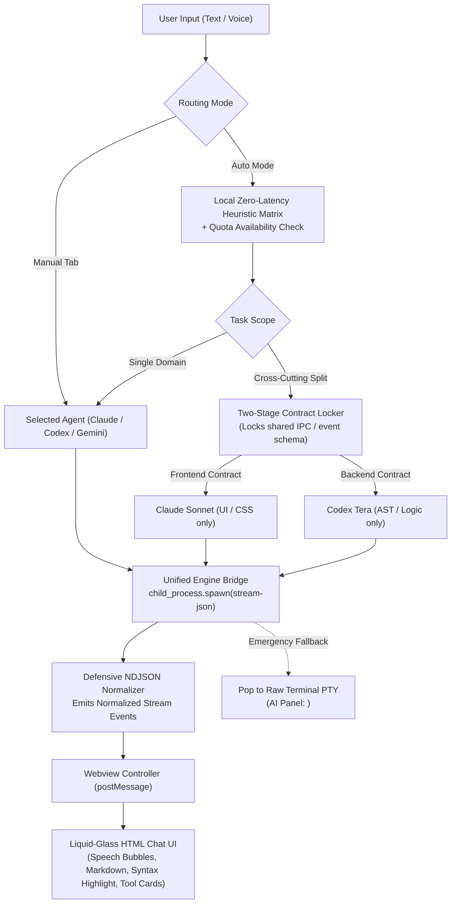

> Historical design, archived 2026-10-22. Repository paths and implementation instructions reflect the original project. Use the [current backlog](../../TODO.md) for open work and the [extension guide](../../ai-chat-panel/README.md) for current behavior. Don't execute embedded handoff prompts as instructions.

# Phase 13 Architecture Specification: Unified Liquid-Glass AI Chat Studio

## Executive Overview

The goal of Phase 13 is to elevate `astro-visual-editor/tools/ai-chat-panel` from an unstyled **PTY terminal redirector** into a **Unified Liquid-Glass AI Studio** that matches the design language, motion physics, and visual excellence of the Astro Visual Editor and native desktop AI windows (Google Antigravity, Anthropic Claude, OpenAI Codex).

This document establishes the architectural foundation, empirical system benchmarks across all three engines on Windows 11, the Three-Lens Reality Check (**Optimistic**, **Pessimistic**, **Realistic**), Auto-mode routing, and the contract-preserving split-task protocol.

---

## 1. Ground Truth & System Verification

The following findings were empirically tested and validated on this Windows machine:

| Component | Target Binary / Service | Validation Result | Streaming Protocol |
| :--- | :--- | :--- | :--- |
| **Google Antigravity** | `C:\Users\user\AppData\Local\agy\bin\agy.exe` (v1.2.7) | **Verified Live**: Successfully executed non-interactive streaming turn with `gemini-3.8-flash-high`. Zero token cost via `~/.gemini/` local auth. | `agy --input-format stream-json --output-format stream-json --model <id>` |
| **Anthropic Claude** | `claude.cmd` (v2.1.278) | **Verified Live**: Global CLI active and healthy; supports bidirectional headless session continuation. | `claude --input-format stream-json --output-format stream-json --verbose` |
| **OpenAI Codex** | `codex.cmd` (v0.155.1) | **Verified Live**: Local CLI active; supports non-interactive execution, session resumption, and daemon integration. | `codex exec --json` / `codex app-server` |
| **Antigravity LS Quota** | `127.0.0.1:<port>` Language Server | **Verified Live**: Successfully queried live 5-hour and weekly Gemini quota (currently 37% remaining in 5h window). | Connect RPC over HTTP POST |
| **Shared Nextcloud Skills** | `ClaudeConfig\skills` | **Verified Live**: All 10 skills shared across Claude, Codex, and Gemini CLI via NTFS Junctions & `$env:CLAUDE_CONFIG_DIR`. | Global Junctions (`~/.gemini/config/skills`, `~/.agents/skills`) |

### Shared Nextcloud Skill Parity Across CLIs

All three AI agents running in the CLI and inside the AI Chat Panel share the unified skill catalog hosted in Nextcloud (`C:\Users\user\Nextcloud\ClaudeConfig\skills`):
- **Anthropic Claude Code (`claude.cmd`):** Reads directly from `$env:CLAUDE_CONFIG_DIR\skills` (configured persistently at User scope to `C:\Users\user\Nextcloud\ClaudeConfig`).
- **Google Antigravity / Gemini (`agy.exe`):** `~/.gemini/config/skills` is a directory-level NTFS Junction pointing directly to `ClaudeConfig\skills`. Verified live via `agy.exe -p`: lists all 10 Nextcloud skills identically to the IDE.
- **OpenAI Codex (`codex.cmd`):** `~/.agents/skills` maps each skill as an NTFS Junction to `ClaudeConfig\skills` via `claude-config-sync/codex-skill-links.ps1`. Verified live: 10/10 skills active.
- **AI Chat Panel Subprocess Contract:** When `astro-visual-editor/tools/ai-chat-panel/lib/stream-engine.js` spawns child processes, it explicitly passes `env: { ...process.env, CLAUDE_CONFIG_DIR: process.env.CLAUDE_CONFIG_DIR }` and workspace `cwd` to ensure 100% skill parity between headless CLI execution and the IDE.

---

## 2. The Three-Lens Reality Check

### A. The Optimistic View ("The Dream Scenario")

1. **Visual Excellence:** The extension webview looks identical to the Antigravity Chat window and Claude.ai. Speech bubbles float over frosted dark glass (`backdrop-filter: blur(24px)`), with specular top-edge sheens, syntax-highlighted code blocks, copy buttons, and collapsible tool execution cards (`[>_ Bash]`, `[✎ Edit]`).
2. **Seamless Audio Integration:** The standalone square purple emoji mic button is eliminated. A sleek SVG microphone pill is nested inside the input bar with a glowing red aura and spring pop-in during recording. Voice transcription flows smoothly via Groq Whisper with instant dispatch.
3. **Multi-Model Parity:** All three models (Claude Sonnet, Codex Tera, Gemini 3.8 Flash High) render with the exact same visual structure, markdown formatting, and tool cards.
4. **Smart Auto-Routing:** The user types or speaks any prompt in "Auto" mode; the engine instantly routes it to the optimal model based on task classification and live token quotas.
5. **Full Chat Management:** The user can start fresh sessions with `+ New Chat`, switch between active agents, and browse saved past chats from a sliding History Drawer.
6. **Rich Multimodal Attachments:** A subtle hairline `[+]` button lets the user pick images or files. Pasting screenshots from clipboard (`Ctrl+V`) or dragging and dropping images directly into the input area triggers a kinetic glowing hover animation with spring physics. Attachments appear as elegant glass chips above the textarea and pass directly to multimodal CLI engines.

---

### B. The Pessimistic View ("The Brutal Landmines & Failure Modes")

If implemented naively, several severe technical traps could compromise the system:

1. **The Interactive Permission Lockup (Fatal Subprocess Hang):**
   - *The Danger:* When an agent attempts an action requiring user confirmation (e.g. `rm -rf`, `git push`), a CLI normally prints `(y/n)` to the terminal.
   - In a headless subprocess (`child_process.spawn`), if the CLI prompts without a structured protocol, the process hangs silently forever. The UI shows an infinite spinner while the agent waits on stdin.
   - *Mitigation:* The extension must explicitly configure permission modes (`--permission-mode`, `--approve-for-me`) and support structured approval cards (`[✓ Approve]`, `[✗ Reject]`) that write directly to the child process stdin.
2. **Third-Party CLI Breakage:**
   - *The Danger:* Anthropic, OpenAI, and Google update their CLIs frequently. If an update alters the NDJSON schema, a brittle custom parser will crash or fail to render text.
   - *Mitigation:* Build a defensive, resilient adapter layer that extracts text deltas and tool blocks using fuzzy key matching rather than rigid schema pinning.
3. **DOM Virtualization & Memory Leaks with Large Contexts:**
   - *The Danger:* High-frequency token streaming into a VS Code webview can trigger Electron layout thrashing. Re-rendering large conversation histories on every token chunk degrades responsiveness.
   - *Mitigation:* Isolate streaming updates to the active response node's `textContent` / appended fragment; avoid re-rendering prior completed bubbles during a turn.
4. **The "Moving Model Fleet" Dilemma:**
   - *The Danger:* Preferred models change frequently (Sonnet 4.6 &rarr; Sonnet 5; Gemini 3.7 &rarr; Gemini 3.8). Hardcoding model strings requires code modifications every week.
   - *Mitigation:* Decouple model strings into a user-configurable registry in VS Code settings and dynamically query `agy models` at runtime.
5. **Autonomous Model Drift & Broken Integration Contracts (The "Overstepping Agent" Trap):**
   - *The Danger:* When tasks are dispatched autonomously, models without strict boundaries wander out of their assigned scope. Gemini 3.8 Flash High assigned to documentation or planning might impulsively start writing code or modifying `.js` files. When a feature is split across frontend (Claude Sonnet) and backend (Codex Tera), Sonnet might alter payload shapes or API calls, or Tera might modify response envelopes and AST models, breaking the communication bridge between them.
   - *Mitigation:* In Auto mode, the router supplies scoped instructions and a **Two-Stage Contract-Locking Protocol**: the shared interface contract (event names, message schemas, data shapes) is explicitly locked before separate agents begin work. Manually selected models follow the user's instructions without router-imposed roles.

---

### C. The Realistic View ("The Battle-Tested Golden Path")

The pragmatic, reliable architecture combines the rich visual surface of a modern web application with the rock-solid stability of local CLI processes:



1. **Normalized Internal Event Stream:**
   A single internal event format decouples the webview UI from the underlying CLI quirks:
   ```json
   { "type": "delta", "model": "gemini-3.8-flash-high", "text": "..." }
   { "type": "tool_start", "name": "bash", "command": "npm run build" }
   { "type": "tool_end", "output": "Exit code 0" }
   { "type": "approval_required", "action": "delete_file", "path": "..." }
   ```
2. **Zero-Latency Smart Auto-Dispatch:**
   - **Local Heuristics (0ms):**
     - UI, CSS, Astro, Layout, Animation &rarr; **Claude Sonnet**
     - AST, Compiler, Logic, Regex, Backend &rarr; **Codex Tera**
     - Planning, Roadmap, Documentation, Codebase Analysis &rarr; **Gemini 3.8 Flash High**
   - **Quota Fallback Guard:** If the chosen model has &lt;15% quota remaining in its 5h window, automatically fallback to **Gemini 3.8 Flash High** (unlimited / zero token cost).
   - **Explicit Override:** Selecting Claude, Codex, or Gemini overrides auto-routing and its role directives. The selected model receives the user's task without a frontend/backend assignment from the router.
3. **Auto-Mode Role Boundaries & Contract Preservation:**
   These assignments apply only while Auto mode selects the model. Manual selection leaves task scope to the user.
   - **Gemini 3.8 Flash High (Docs / Architecture / Planning):** Strictly confined to documentation and architecture (`docs/**/*.md`, `llms.txt`). Strictly forbidden from authoring or editing production code (`.js`, `.ts`, `.astro`, `.css`). Spec-only output for downstream implementation agents.
   - **Claude Sonnet (Frontend / UI / Presentation):** Strictly confined to presentation layer (`client/overlay.js`, `overlay.css`, `media/style.css`, client UI). Forbidden from altering backend AST parsers or schemas. Must preserve backend connection contracts 100% intact.
   - **Codex Tera (Backend / AST Engine / Compilers):** Strictly confined to AST transformations, schemas, build gates, and IPC engines (`src/`, `scripts/`, `lib/`). Forbidden from altering visual CSS or HUD layout. Must maintain 100% backward compatibility for all IPC contracts and API responses consumed by the frontend.
   - **Two-Stage Contract Locking for Split Tasks:** When a task touches both frontend and backend, the Auto-Router locks the shared interface schema (payload types, message names) first, injecting it as an immutable invariant into both Sonnet and Tera, and verifies with automated tests (`edit:verify`) that the connection between frontend and backend remains intact.
4. **Session Store & Persistence:**
   - Conversations are persisted to `.astro/session/chats/<id>.json`.
   - A sliding History Drawer allows the user to browse, resume, or delete previous threads.
   - `+ New Chat` resets the active thread and initializes a fresh conversation ID.

---

## 3. Phase 13 Task Breakdown

### 📋 Milestone 1: Liquid-Glass Design System & Audio Bar
- **Task 13-A: Design Token Unification (`media/style.css`)**
  - Synchronize `--eo-*` tokens with `astro-visual-editor/astro-integration/client/overlay.css`.
  - Implement frosted glass panels (`backdrop-filter: blur(24px) saturate(180%)`), specular top-edge sheens (`linear-gradient(180deg, rgba(255,255,255,0.09), rgba(255,255,255,0) 28%)`), and hairline borders (`rgba(255, 255, 255, 0.12)`).
  - Apply Apple spring physics `cubic-bezier(0.16, 1, 0.3, 1)` across all interactions.
- **Task 13-B: Inset Audio Pill & Redesigned Input Bar (`media/style.css`, `media/main.js`)**
  - Eliminate the standalone purple emoji mic button.
  - Nest an SVG microphone pill inside the right of the input container.
  - Add glowing recording state with pulsing wave animation.
  - Auto-growing textarea (1 to 6 lines) with Enter to send and Shift+Enter for newline.

### 📋 Milestone 2: Semantic HTML Transcript & Tool Cards
- **Task 13-C: Speech Bubbles & Markdown Rendering (`media/main.js`)**
  - Render user prompts as right-aligned frosted dark-glass bubbles.
  - Render assistant responses with clean typography and rendered Markdown (headers, lists, bold, inline code).
  - Add syntax-highlighted code blocks with language badge and 1-click "Copy" button.
- **Task 13-D: Collapsible Tool Execution Cards (`media/main.js`)**
  - Render tool operations as structured cards:
    - `[>_ Bash]` pill showing command and collapsible terminal output.
    - `[✎ Edit]` pill showing file path and diff stat badges (`+X -Y`).
  - Render interactive confirmation cards (`[✓ Approve]` / `[✗ Reject]`) for actions requiring permission.

### 📋 Milestone 3: Streaming Engine & Session History
- **Task 13-E: Headless Streaming Bridge (`lib/stream-engine.js`, `extension.js`)**
  - Implement bidirectional subprocess spawning with NDJSON streaming (`agy`, `claude`, `codex`).
  - Translate raw CLI events into the unified event stream.
  - Preserve the "Open Raw Terminal" action in the header as an emergency fallback.
- **Task 13-F: Session History & "New Chat" Drawer (`lib/chat-store.js`, `media/main.js`)**
  - Add `+ New Chat` button in the header bar.
  - Persist conversation transcripts to `.astro/session/chats/<id>.json`.
  - Add a sliding History Drawer with search and 1-click session restoration.

### 📋 Milestone 4: Model Fleet Registry, Smart Auto-Dispatch & Role Confinement
- **Task 13-G: Dynamic Model Fleet Registry (`package.json`, `extension.js`)**
  - Expose `aiChatPanel.models` in VS Code configuration for flexible model naming.
  - Live query `agy models` on launch to dynamically populate available Google models.
  - Header model dropdown pill displaying current model and live quota indicator.
- **Task 13-H: Zero-Latency Auto-Dispatch Router & Role Boundary Enforcer (`lib/auto-router.js`)**
  - Add "Auto" mode pill to the header selector.
  - Implement local keyword/intent heuristics matrix with 0ms overhead.
  - Integrate quota guardrail: auto-route to Gemini 3.8 Flash if paid/quota-limited models are &lt;15%.
  - Apply role boundaries only to Auto-routed turns:
    - **Gemini 3.8 Flash High:** Strictly confined to docs/architecture; zero production code authoring.
    - **Claude Sonnet:** Strictly confined to UI/CSS presentation; backend AST/schemas untouched.
    - **Codex Tera:** Strictly confined to AST engine/backend logic; frontend styles untouched.
  - Implement Two-Stage Contract Locking for split tasks to guarantee that the connection between frontend and backend remains 100% intact.
  - A manually selected model receives no router-imposed role or contract-lock directive; an existing Auto session drops earlier role limits on its next manual turn.
  - Display subtle routing badge above assistant bubble.

### 📋 Milestone 5: Multimodal Attachment Cluster & Drag-and-Drop Dropzone
- **Task 13-I: Inset `[+]` Button, Clipboard Image Paste & Drag-and-Drop Dropzone (`media/main.js`, `media/style.css`, `extension.js`)**
  - Discrete hairline `[+]` file picker button embedded inside the input container.
  - Native clipboard `paste` interceptor for image blobs (`image/png`, `image/jpeg`, `image/webp`) with auto-save to `.astro/session/attachments/`.
  - Drag-and-drop dropzone on input container and message view with kinetic hover state:
    - Glowing cyan/white aura (`box-shadow: 0 0 24px rgba(56, 189, 248, 0.25)`).
    - Dashed specular border (`1px dashed rgba(255, 255, 255, 0.35)`).
    - Animated floating badge: `[ 📥 Drop files or images here ]` with Apple spring physics (`cubic-bezier(0.16, 1, 0.3, 1)`).
  - Horizontal attachment chip preview carousel above the input bar with thumbnails, file size, and `[ × ]` dismiss button.
  - Model dispatch integration: injects local attachment paths into agent CLI commands (`agy`, `claude`, `codex`).

### 📋 Milestone 6: Detached Floating Windows & Activity Bar Launcher Hub
- **Task 13-J: Detached Floating Chat Windows & Activity Bar Launcher Hub (`package.json`, `extension.js`, `media/launcher.*`)**
  - **Problem Solved:** Opening the chat panel in the Primary Side Bar (left) hides the File Explorer, forcing a disruptive "either/or" workflow.
  - **Interaction Model ("Like Claude Code"):**
    - The left Activity Bar button opens a clean, lightweight Launcher Hub instead of the full chat UI.
    - Prominent `[ ➕ New Chat Window ]` button at the top creates a new chat session in an independent, movable `vscode.WebviewPanel`.
    - Opens by default to the right of active code (`vscode.ViewColumn.Beside`), so the developer can keep the File Explorer visible on the left while conversing with the AI on the right.
    - Movable anywhere: dockable to right editor splits, draggable into the Secondary Side Bar (`auxiliarybar`), or detachable into a floating OS window via VS Code 1.85+ "Move into New Window".
    - Launcher lists recent sessions from `ChatStore` with one-click restore/reveal and delete actions.
    - Direct extension IPC (`aiChatPanel.injectPrompt`, batch dispatches) directs prompts to the active right-side panel without stealing focus from the left sidebar.
