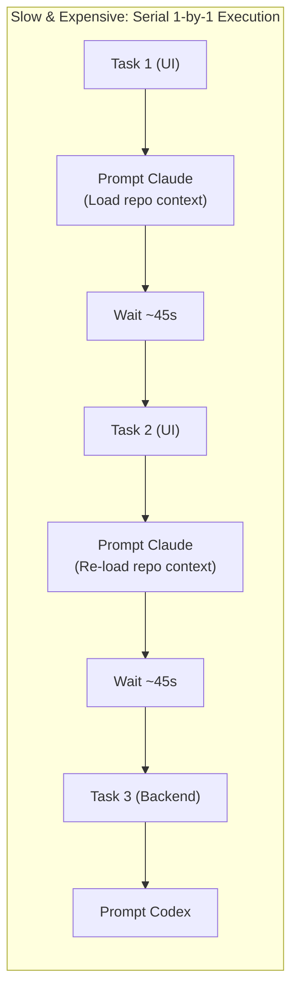
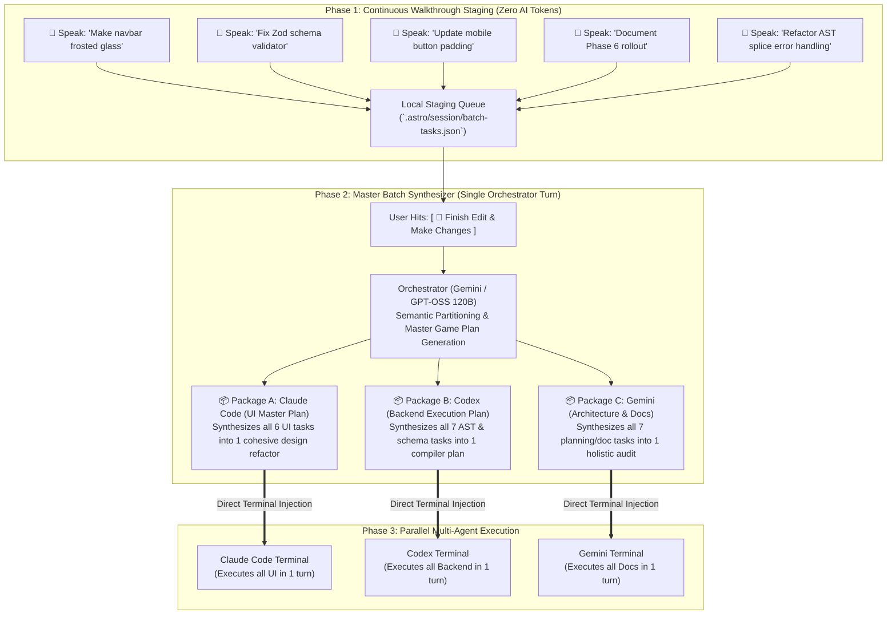

# Batch Task Staging & Multi-Agent Synthesis — Architecture Specification (v1.0)

**Document Purpose:** Complete architectural design for the **Batch Staging & Multi-Agent Synthesizer** workflow. This replaces slow, token-expensive serial 1-by-1 prompt execution with a continuous walkthrough staging buffer, an automated semantic partitioner, and parallel master-package dispatch to **Claude Code**, **Codex**, and **Gemini**.

> **Implementation status (corrected against the shipped code, not the original design below):**
> - **The "orchestrator" is a deterministic keyword classifier, not an LLM call.** Sections 3 and 4 below describe Gemini/GPT-OSS 120B doing the semantic partitioning and prose synthesis — that was never built that way. The real `classifyTask()`/`synthesizeBatch()` (`astro-visual-editor/tools/voice-router/lib/batch-synthesizer.mjs`) route by plain keyword/file-extension matching and assemble each package from a fixed template, with **zero API calls**. This is arguably better than the original design (instant, free, fully deterministic, testable without mocking an LLM) but it means the "Master Game-Plan Synthesis" example in Stage 3 below — specific CSS values and line numbers the orchestrator supposedly writes — is not what the real output looks like. See "Real output example" after Stage 3 for what it actually produces: a restated, numbered list of the staged tasks, not synthesized implementation detail.
> - **There is no automatic parallel dispatch into the AI Chat Panel yet.** Stage 4 below describes all 3 packages being sent via `aiChatPanel.injectPrompt` automatically. What's actually built: the CLI (`router.mjs --batch`) copies one "primary" package to the clipboard; the browser ("Finish Edit" button in `overlay.js`) copies all generated packages concatenated into one clipboard blob. Wiring either of those into `aiChatPanel.injectPrompt` for real parallel dispatch is unbuilt — a natural next step, not a shipped behavior.
> - A real code review found and fixed 12 bugs in the first implementation of this feature — including quota failover being completely non-functional on both entry points, a data-loss bug that silently discarded real Codex tasks, and a crash on an empty batch. See `astro-visual-editor/docs/content-editor-todo.md`'s **P8-J** for the full account and verification evidence.

---

## 1. The Core Inefficiency: Serial vs. Batch Execution

### Today's Serial Anti-Pattern (1-by-1 Execution)
When a developer reviews a site and identifies 10 improvements:

- **Token Bleed:** Loading project context, AST maps, and system prompts 10 separate times burns 10x the context tokens.
- **Cognitive Friction:** The developer must stop exploring, wait for the AI to finish, review the code, and then find the next item.
- **Code Thrashing:** The AI makes micro-edits in isolation, frequently reverting earlier changes or creating conflicting ad-hoc styles.

---

## 2. The Solution: Continuous Walkthrough & Master Batch Synthesis

Instead of triggering an AI on every click, the developer stays in pure creative flow:



---

## 3. Detailed Stage Breakdown

### Stage 1: Continuous Walkthrough Staging
1. In the Content Editor (`overlay.js`) or via the Voice Router hotkey:
   - Clicking an element or speaking records a task into `.astro/session/batch-tasks.json`.
   - Each task captures:
     - `rawPrompt`: Spoken text or directive.
     - `activeFile`: The AST source file containing the element.
     - `path`: Key path within AST / frontmatter.
     - `currentValue`: Live DOM / YAML value.
     - `shotPath`: Local screenshot on disk (`.astro/session/shots/`) for visual provenance.
   - **Zero API calls to frontier coding models occur during this stage.**

### Stage 2: The "Finish Edit" Synthesis Trigger
- When the user finishes reviewing the page, they click:
  `[ 🚀 Finish Edit & Make Changes (N tasks) ]`
- The system reads all accumulated tasks and submits them to the **Batch Synthesizer**.

### Stage 3: Semantic Partitioning & Game-Plan Generation
The orchestrator (Gemini 2.0 Flash or Groq GPT-OSS 120B) processes the entire list in a single turn. It executes two sub-steps:

1. **Partitioning by Specialization & Quotas:**
   - **Claude Code (UI / CSS / Polish):** Receives layout, glassmorphism, typography, and animation tasks. *(If Claude 5h quota < 20%, downgraded to Codex with injected design tokens).*
   - **Codex (AST / Code / CLI / Tests):** Receives TypeScript, Zod, PowerShell, test harnesses, and bugfixes.
   - **Gemini (Architecture / Docs):** Receives roadmap reviews, cross-repo indexing, and documentation tasks.

2. **Master Game-Plan Synthesis:**
   - Instead of a disconnected list of 6 bullets, the orchestrator writes a **holistic architectural directive** for each agent:
   ```markdown
   ### Master UI Refactoring Directive (Batch of 6 Tasks)
   
   **Cohesive Goal:** Upgrade the navigation and card components to the 2026 Apple Liquid Glass design language without regressions.
   
   **Architecture Plan:**
   1. In `site/src/layouts/Screen.astro`, update root glass tokens:
      - Set `--surface-glass` to `rgba(255, 255, 255, 0.04)` with `backdrop-filter: blur(28px)`.
      - Unify hairline border `1px solid rgba(255, 255, 255, 0.08)`.
   2. Refactor hero buttons to use spring easing `cubic-bezier(0.16, 1, 0.3, 1)`.
   3. Update mobile responsive padding on lines 140-165.
   
   **Target Files:**
   - `site/src/layouts/Screen.astro`
   - `site/src/lib/graphic-style.ts`
   ```
   **This is the original, aspirational design — not what the shipped code produces.** Real output, captured live from a `curl` against the running dev server's `/batch-tasks/synthesize` route, for one UI task and one backend task:
   ```markdown
   ### Master UI Refactoring Directive (1 tasks bundled for Claude Sonnet)
   *Cohesive Goal: Apply unified Apple Liquid Glass styling, typography, and layout refinements across the affected components.*

   **Consolidated Target Files:**
   - `site/src/pages/index.astro`

   **Actionable Step-by-Step Game Plan:**
   1. **`site/src/pages/index.astro`**
      - Directive: add a glassmorphism border to the project card

   **Execution Rules:**
   - Implement all changes coherently in a single pass.
   - Preserve existing component structure and ensure 0px layout shift.
   ```
   It restates the staged task under a fixed header/footer template — it does not invent CSS values, line numbers, or an "architecture plan" the way the fabricated example above implies. The actual implementation-writing work still happens when the target agent (Claude/Codex) reads this package, same as today.

### Stage 4: Parallel Injection into the AI Chat Panel
- The 3 generated packages are dispatched **in parallel**:
  - `aiChatPanel.injectPrompt({ targetModel: 'claude', prompt: packageClaude })`
  - `aiChatPanel.injectPrompt({ targetModel: 'codex', prompt: packageCodex })`
  - `aiChatPanel.injectPrompt({ targetModel: 'gemini', prompt: packageGemini })`
- Claude Code, Codex, and Gemini run simultaneously.
- Total turnaround time: **1 turn per agent**, completing 20 changes in parallel in under 60 seconds!

---

## 4. Token & Cost Economics Comparison

| Metric | Serial Execution (1-by-1) | Batch Staging & Synthesis | Efficiency Gain |
|---|---|---|---|
| **Frontier API Calls** | 20 separate turns | 3 parallel turns (1 per agent) | **85% fewer API round-trips** |
| **Context Overhead** | 20x codebase context re-reads | 3x codebase context reads | **~85% context token savings** |
| **Developer Wait Time** | 20 × 40s = ~13 minutes | 1 × 45s parallel = ~45 seconds | **17x faster developer turnaround** |
| **Code Coherence** | Frequent regressions & micro-conflicts | Unified master refactor plan | **Zero conflicting micro-edits** |
| **Claude Pro Quota Risk** | Burns 20 Claude prompts | Burns exactly 1 Claude prompt | **Preserves 5-hour quota** |

---

## 5. Integration with Existing Repositories

1. **Astro Content Editor (`astro-visual-editor/astro-integration/client/overlay.js`):**
   - Replace the simple `"Hand Over Batch to AI"` clipboard copy with `"Finish Edit & Dispatch Batch"`.
   - Sends the JSON queue to the `/batch-tasks/synthesize` endpoint.
2. **Voice Router (`astro-visual-editor/tools/voice-router/`):**
   - Add `lib/batch-synthesizer.mjs`: Reads `.astro/session/batch-tasks.json`, calls Groq / Gemini for semantic partitioning, and outputs the 3 structured packages.
3. **AI Chat Panel (`astro-visual-editor/tools/ai-chat-panel/`):**
   - Receives the 3 packages and feeds them into the respective Claude, Codex, and Gemini background PTY sessions concurrently.
