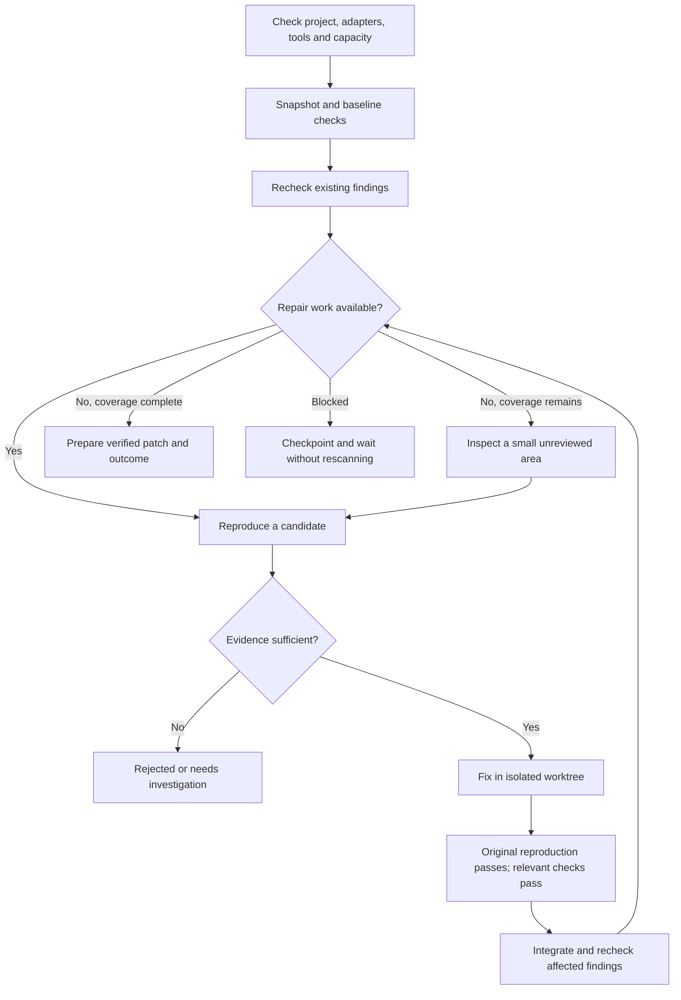

> Proposal linked to LOOP-01 in the [backlog](../../TODO.md). Integration was interrupted; reconcile this design with the current working tree before implementing. The [loop guide](../loops.md) documents existing behavior and may lag recent uncommitted work.

# Loop redesign proposal

2026-10-21. Scope: Clanker's full loop, using the completed eight-cycle Clanker review as the failure case. This document specifies future behavior; it does not apply the old loop's patch or change running jobs.

Reliable unattended repair is the proposed default. Retain the private checkout, Git worktrees, checkpoints, existing project checks and cumulative patch. Replace the fixed sequence of repeated whole-project scans with a persistent queue of findings and the evidence needed to resolve them.

## What the last run establishes

| Observation | Consequence for the design |
| --- | --- |
| Only 27 of 88 scout attempts completed. Failures included 27 inactivity timeouts, 24 forbidden-tool attempts and five output-limit errors. | Check the transport contract and stop repeated failures before scheduling another broad scan. |
| Cycles 4–8 produced no fixes while editors reported insufficient quota. | Pause discovery when repair capacity is unavailable; resume the existing queue when capacity returns. |
| A verifier rated the working BOM-removal function “confirmed 10/10.” Its excerpt actually contained the invisible BOM character. | Confidence and agreement cannot establish a defect. Require a reproduction or leave the claim unproven. |
| The constructor initializes the Telegram secret, which the claimed missing-secret bypass ignored. | Verification must inspect construction, callers and guards, rather than just the cited statement. |
| Five visual findings remained in the backlog although the last capture reported zero findings across 102 states. | Recheck old findings against current evidence and distinguish resolved, disproven and inconclusive outcomes. |
| Nine finding labels counted as fixed, including several controls affected by shared layout or detector changes. | Count distinct root causes and distinguish product changes from detector corrections. |
| Repairs stayed in the private checkout, while the card read “Finished.” | Report the actual stop reason and whether a verified patch has reached the real project. |

The 12,954,361-token cycle ledger includes estimates: checkpoints record 28 calls with unknown usage. It also omits editor usage from the cycle budget and can lose usage from earlier retries. Treat that figure as accounting from the old engine, not an exact measured total.

## Proposed execution flow

Discovery runs only while the queue has room and repair capacity exists. Audit-only mode can continue discovery without an editor, but the user selects that mode explicitly.

## Evidence decides whether a finding is actionable

A candidate records its trigger, expected and observed behavior, source revision, relevant files and an independent reproduction. The verifier gets the relevant function, its constructor or initialization, callers and existing tests; it can request bounded additional context. Show invisible source characters with an annotated view, such as `U+FEFF`, alongside unchanged source and line numbers.

For an automatic code repair, the controller must observe a focused reproduction fail for the claimed behavior before the change and pass afterwards. A missing dependency, denied command, parse failure in the test itself or transport timeout is inconclusive, not proof. Check that the reproduction exercises the production path rather than a test that manually creates an impossible state or merely asserts the proposed implementation.

Some valid concerns do not have a practical automated reproduction. Keep them as “Needs investigation,” with the reasoning and missing evidence visible. They don't qualify for an unattended repair. Performance findings need a representative measurement; suggestions and compliance indicators remain separate from the repair queue.

Use a separate verifier role and model setting. The user can choose any supported model for that role, including the scout model. A different model can provide another perspective, but it doesn't replace executable evidence. Preserve manual selections exactly; if a chosen model is unavailable, show the reason and wait. Any fallback must follow a policy the user explicitly enabled and appear in the activity log.

## Schedule repairs before more discovery

Start with three focused discovery workers and one editor. These are proposed pilot limits, not measured optima. Group the existing review questions into code behavior and lifecycle, security and boundaries, and changed code with its tests. Keep the other questions available as targeted passes. A single run needn't invoke every aspect.

Maintain a small active queue, initially at most five reproducible defects. Discovery stops adding work when that queue is full. Track coverage by source hash, files and inspected ranges; truncated excerpts and failed calls leave coverage gaps. Four rotating packets cannot justify “whole project reviewed.” Only re-inspect unchanged code when evidence or a relevant dependency changes.

For a finding, use this lifecycle:

`candidate → needs context → reproduced → fixing → verified in snapshot → patch ready → applied to project → verified in project`

Record rejected claims, obsolete findings, blocked work and inconclusive checks separately. Keep stable finding IDs across cycles. Link duplicate observations to one root cause, without merging different inputs merely because titles sound similar. A rejection also records the source revision and explanation so another scout doesn't repeatedly propose it on unchanged code.

Before each repair, rerun the existing reproduction against the current private checkout. After integration, recheck affected findings. For browser findings, retain the route, viewport, scenario, stress configuration and element identity so the same check can run again. A zero result closes a finding only if that scenario ran successfully; a missing or skipped capture leaves it unresolved.

Serialize edits that share files or behavior. Initially, one editor avoids the repeated CSS cherry-pick conflicts seen in the old run. Later, allow parallel editors only for disjoint changes and always rerun verification after integration. Separate detector changes from product changes: a detector correction needs a negative fixture for the false alarm and a positive fixture proving it still catches a real defect.

## Account for every call before admitting it

The current `Budget` records charges after completion. Parallel scouts each see the same remaining allowance, and editor results store `usage` without charging it. Fix these rules before raising any limits:

- Reserve a call allowance atomically before it starts, including every retry and editor invocation. Reconcile measured usage once, using a durable attempt ID so restarts cannot duplicate charges.
- Keep measured tokens, provisional charges, outstanding reservations and calls with missing telemetry separate. Preserve uncertainty rather than printing an estimated charge as measured usage.
- Protect capacity for reproduction, editing and verification. An initial allocation is 20% discovery, 25% reproduction and review, 40% edits and 15% final verification. These are tunable admission budgets, not a conversion between tokens and subscription quota.
- Gate work against the actual selected providers. The current job-level admission asks for Gemini quota even when roles use other providers. A quota percentage does not guarantee capacity; rate-limit replies and reset information also affect admission.

If repair capacity falls below the configured allowance, checkpoint and enter “Waiting for editor quota.” Don't spend the remaining discovery budget simply because Gemini can still answer. Wake the same job at the known reset or retry interval, preserving its queue and coverage.

Reservations control admission; they can't impose a provider-side hard token ceiling when a CLI exposes no such limit. Keep that distinction visible when reporting an overrun or missing telemetry.

## Repair the model transport contract

Validate supported CLI flags and role capabilities at startup, and inspect the first actual request's event stream before expanding concurrency. Capture installed versions and adapter versions in the run record. A declared empty tool list isn't proof that a provider enforces it; the last run's forbidden-tool failures show that this needs an adapter-level test.

Scouts receive bounded source and return small structured claims. Verifiers get controlled read access and a controller-run test interface in the scratch checkout. Editors work only in their assigned worktree. Screenshot review uses an image-capable adapter whose real tool events the controller validates. Keep project secrets out of model context and logs.

Separate a bounded final JSON response from streamed diagnostic output. Drain and parse output incrementally with a bounded memory buffer and a capped log file; don't abort an otherwise valid answer just because verbose streaming crossed 512 KB. Bound individual event size, final response size and disk usage separately. Schema errors get at most one repair attempt using the existing answer and validation error; don't resend the entire repository packet for every formatting problem.

Classify failures as queue wait, provider refusal, rate limit, invalid response, incompatible tools, execution failure or failed evidence check. Initially stop expansion after two consecutive transport failures on an adapter; finish already admitted work safely and enter an explicit blocked state. Resume after an observed recovery or an explicit retry. Don't reinterpret adapter failure as a clean scout result.

## Make completion and delivery explicit

The run card should show the project path, snapshot age, resolved model for each role, completed coverage, responding and waiting calls, reproduced defects, verified repairs and blockers. Token figures state whether they are measured, reserved or unknown. Every accepted finding links to its reproduction and test output.

Use distinct end states: “Verified patch ready,” “No reproduced defects in completed coverage,” “Waiting for quota,” “Needs investigation,” “Budget exhausted” and “Stopped.” A run cap never produces a green completion claim. When checks or coverage are incomplete, say so even if all completed checks passed.

Keep reviewed patch delivery as the default. Expose a clear “Apply verified patch” action with a diff and test summary. Before applying, compare the real project to the captured baseline, including dirty files, and refuse conflicting application. Rerun affected checks in the real project before claiming “Applied and verified.” Automatic application can be a separate, explicit per-project setting; the controller must preserve intervening edits and limit rollback to its own changes. Publishing and deployment remain separate operations.

The setup screen must show the selected project and path prominently. The run discussed here inspected Clanker even though this conversation belongs to Wittmann Website.

## Implementation order and acceptance checks

| Delivery | Existing code to change | Required evidence |
| --- | --- | --- |
| Accounting and blocked states | `loop-engine.js`, `loop-agents.js`, `investigation-manager.js`, `investigation-commands.js` | Concurrent reservations cannot oversubscribe the configured admission budget; editor and retry usage count; unknown usage remains visible; blocked editors cause zero additional scout dispatches. |
| Finding store and reproduction gate | `loop-aspects.js`, `loop-source.js`, engine checkpoints | A BOM claim fails verification, a normally initialized webhook rejects a missing token, and the known Codex/parser, path-traversal and scheduler defects have executable evidence. Uncertain claims remain uncertain. |
| Transport and coverage | `investigation-runner.js`, `investigation-fixer.js`, `loop-exec.js`, `loop-roles.js` | Recorded streams cover large outputs, bad JSON, retries, silence, tool mismatch, cancellation and restart without losing accounting. Failed scans leave coverage gaps. Selected models remain unchanged. |
| Queue-driven orchestration and delivery UI | Engine, manager, visual capture, `media/investigations.js` | Related CSS repairs serialize; disappeared visual findings leave the backlog; a run cap reads “Budget exhausted”; patch-ready and applied states remain distinct. |

Use the last run's real and false findings as small local fixtures, excluding private histories and credentials. Fake adapters and recorded event shapes should exercise failures without sending test prompts to live providers. Resume old jobs through their existing engine; migrate historical findings as unverified records, preserving their reports and patches. Never reinterpret an old “confirmed” rating as a successful reproduction.

Before enabling unattended repair, replay those fixtures and run one bounded pilot. Measure reproduced defects, correct repairs per distinct root cause, false acceptances, adapter completion rate, actual measured tokens and unknown usage. Compare with the old run's results; don't declare savings from proposed budgets alone.

The first implementation should make a blocked or uncertain run cheap and honest. Add more concurrency only after the evidence and accounting hold up.
